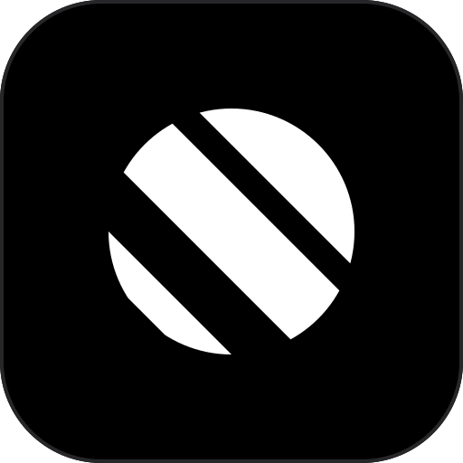

<div align="center">

```
  ██████╗  ██████╗  ██████╗ ████████╗███████╗ ██████╗ ██╗     ██╗ ██████╗ 
  ██╔══██╗██╔═══██╗██╔══██╗╚══██╔══╝██╔════╝██╔═══██╗██║     ██║██╔═══██╗
  ██████╔╝██║   ██║██████╔╝   ██║   █████╗  ██║   ██║██║     ██║██║   ██║
  ██╔═══╝ ██║   ██║██╔══██╗   ██║   ██╔══╝  ██║   ██║██║     ██║██║   ██║
  ██║     ╚██████╔╝██║  ██║   ██║   ██║     ╚██████╔╝███████╗██║╚██████╔╝
  ╚═╝      ╚═════╝ ╚═╝  ╚═╝   ╚═╝   ╚═╝      ╚═════╝ ╚══════╝╚═╝ ╚═════╝ 
```


<br/>

<a href="https://www.ilyankhan.tech">
  
</a>

<h3><code>&lt; CINEMATIC WEB EXPERIENCES x HIGH-PRECISION MACHINE LEARNING /&gt;</code></h3>

<p align="center">
  <a href="https://www.ilyankhan.tech">
    
  </a>
  <a href="https://github.com/Ilyan321/portfolio-v2/actions/workflows/ci.yml">
    
  </a>
  <a href="https://huggingface.co/Ilyankhan69">
    
  </a>
  <a href="https://linkedin.com/in/ilyan-khan-480341359">
    
  </a>
</p>

</div>

---

<br/>

## 🎬 ACT I: THE SCENE & ARCHITECTURE

```
┌─────────────────────────────────────────────────────────────────────────────┐
│                             SYSTEM TOPOLOGY                                 │
│                                                                             │
│  [ CLIENT RUNTIME ]                                                         │
│     │                                                                       │
│     ├── 3D Canvas  ─────────►  @react-three/fiber + @react-three/drei      │
│     ├── Kinetic View  ──────►  GSAP ScrollTrigger + Scanline Raymarching    │
│     ├── Inertial Flow ──────►  Lenis Smooth Scroll Engine                   │
│     └── Motion State  ──────►  Framer Motion Staggered Coordinate Transforms│
│                                                                             │
│  [ CORE FOUNDATION ]                                                        │
│     │                                                                       │
│     ├── App Router  ────────►  Next.js 15 (Turbopack Engine)                │
│     ├── Visual Tokens ──────►  Tailwind CSS v4 + Deep Forest Editorial      │
│     ├── Type Contract ──────►  TypeScript Strict + AST Safety Protocols     │
│     └── Deployment ─────────►  Vercel Edge Network + GitHub Actions CI/CD   │
└─────────────────────────────────────────────────────────────────────────────┘
```

<br/>

## 💎 ACT II: VISUAL IDENTITY & CINEMATICS

<table align="center" width="100%">
  <tr>
    <td width="30%" align="center" style="background:#051F20; border: 1px solid #163832; border-radius: 12px; padding: 20px;">
      <br/>
      <br/>
      <b>OFFICIAL EMBLEM</b><br/>
      <sub>Vector Monogram Slices</sub>
    </td>
    <td width="70%" style="background:#090a0f; border: 1px solid #27272A; border-radius: 12px; padding: 20px;">
      <h4>🌌 Kinetic Design System</h4>
      <ul>
        <li><b>Editorial Sage & Deep Night Forest:</b> Custom palette calibrated for deep visual focus and high-contrast ergonomics.</li>
        <li><b>3D Interactive Monolith:</b> Floating translucent layers responding in real time to pointer parallax and scroll momentum.</li>
        <li><b>CRT & Scanline Aesthetics:</b> Subtle HUD scanlines with film grain noise and typography in <code>Space Grotesk</code>, <code>Inter</code>, and <code>JetBrains Mono</code>.</li>
        <li><b>Sub-second First Load:</b> Optimized vector assets, zero heavy video payloads, purely client-accelerated shaders and canvas passes.</li>
      </ul>
    </td>
  </tr>
</table>

<br/>

---

<br/>

## ⚡ ACT III: THE TECH ARSENAL

<div align="center">

| DISCIPLINE | WEAPONS OF CHOICE | SPECIALTY |
| :--- | :--- | :--- |
| **Generative AI** | `PyTorch` `LoRA / QLoRA` `Unsloth` `FAISS` `LangChain` | Custom LLM Fine-Tuning & AST Guardrails |
| **Full-Stack Web** | `Next.js 15` `React 18` `TypeScript` `Tailwind v4` | High-frequency responsive interfaces |
| **Interactive 3D** | `Three.js` `R3F` `Drei` `GSAP` `Lenis` | Physics-based viewport interactions |
| **Backend & Cloud** | `Python` `FastAPI` `PostgreSQL` `Supabase` `Docker` | Real-time inferencing & reliable state sync |

</div>

<br/>

---

<br/>

## 🛰️ ACT IV: FLAGSHIP PROTOCOLS

```bash
# REVEAL SPOTLIGHT
$ curl -s https://api.ilyankhan.tech/projects/schema-aware-sql-agent | jq
```

```json
{
  "protocol": "Schema-Aware SQL Agent",
  "model_core": "LLaMA-3-8B-Instruct (LoRA / Unsloth quantized to 4-bit)",
  "benchmark": "Yale Spider Multi-Table Complex Join Benchmark",
  "security_firewall": "Python Abstract Syntax Tree (AST) deterministic filter",
  "guarantee": "100% Mutation Safety & 0ms destructive query leakage"
}
```

<br/>

---

<br/>

## 🛠️ MISSION CONTROL: RUN LOCALLY

```zsh
# 1. Clone the transmission
git clone https://github.com/Ilyan321/portfolio-v2.git
cd portfolio-v2

# 2. Provision dependencies
npm install --legacy-peer-deps

# 3. Ignite development warp engine
npm run dev

# 4. Open telemetry console
open http://localhost:3000
```

<br/>

---

<br/>

<div align="center">

### 📡 CONNECT WITH MISSION CONTROL

[](https://github.com/Ilyan321)
[](https://huggingface.co/Ilyankhan69)
[](https://linkedin.com/in/ilyan-khan-480341359)
[](mailto:ilyaankhan342@gmail.com)

<br/>


<sub>Crafted with precision by <b>Ilyan Khan</b> • QUEST Nawabshah</sub>

</div>
