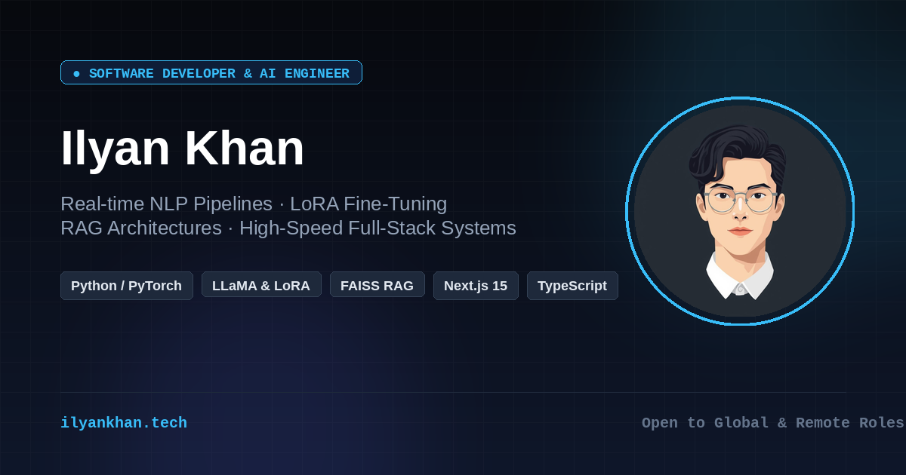

<div align="center">

```
  ██████╗  ██████╗  ██████╗ ████████╗███████╗ ██████╗ ██╗     ██╗ ██████╗ 
  ██╔══██╗██╔═══██╗██╔══██╗╚══██╔══╝██╔════╝██╔═══██╗██║     ██║██╔═══██╗
  ██████╔╝██║   ██║██████╔╝   ██║   █████╗  ██║   ██║██║     ██║██║   ██║
  ██╔═══╝ ██║   ██║██╔══██╗   ██║   ██╔══╝  ██║   ██║██║     ██║██║   ██║
  ██║     ╚██████╔╝██║  ██║   ██║   ██║     ╚██████╔╝███████╗██║╚██████╔╝
  ╚═╝      ╚═════╝ ╚═╝  ╚═╝   ╚═╝   ╚═╝      ╚═════╝ ╚══════╝╚═╝ ╚═════╝ 
```


<br/>

<a href="https://www.ilyankhan.tech">
  
</a>


<p align="center">
  <a href="https://www.ilyankhan.tech">
    
  </a>
  <a href="https://github.com/Ilyan321/portfolio-v2/actions/workflows/ci.yml">
    
  </a>
  <a href="https://huggingface.co/Ilyankhan69">
    
  </a>
  <a href="https://linkedin.com/in/ilyan-khan-480341359">
    
  </a>
</p>

</div>

---

<br/>

## 📼 FRAME 01 // PRODUCTION TRAILER & PREVIEW

<div align="center">

<table border="0" cellpadding="0" cellspacing="0" width="100%">
  <tr>
    <td align="center" style="background: #051F20; border: 1px solid #163832; border-radius: 12px; padding: 12px;">
      <a href="https://www.ilyankhan.tech">
        
      </a>
      <p align="center">
        <sub><b>VIEWING DECK:</b> Next.js 15 • Three.js WebGL Core • GSAP Ambient Scanlines • Space Grotesk Display</sub>
      </p>
    </td>
  </tr>
</table>

</div>

<br/>

---

<br/>

## 🛰️ FRAME 02 // REAL-TIME SYSTEM ARCHITECTURE

```
╔═══════════════════════════════════════════════════════════════════════════════════╗
║                      ILYAN-OS : CLIENT & INFERENCE RUNTIME                        ║
╠═══════════════════════════════════════════════════════════════════════════════════╣
║                                                                                   ║
║   [ VIEWPORT CANVAS ] ─────────────────────────► [ INTERACTION MATRIX ]           ║
║   • @react-three/fiber 3D Viewport              • Pointer-tracked Parallax        ║
║   • @react-three/drei Layered Geometries        • Lenis Smooth Inertial Physics   ║
║   • GSAP ScrollTrigger Scanline Sweeper         • Framer Motion Word Reveals      ║
║                                                                                   ║
║   [ FULL-STACK ENGINE ] ───────────────────────► [ DATA & AUDIT SHIELD ]          ║
║   • Next.js 15 App Router (Turbopack)           • PostgreSQL & Supabase Storage   ║
║   • Tailwind CSS v4 System Tokens               • Resend Automated Notification   ║
║   • Editorial Sage (#8EB69B) / Forest (#051F20) • GitHub Actions CI/CD (Node 20)  ║
║                                                                                   ║
╚═══════════════════════════════════════════════════════════════════════════════════╝
```

<br/>

---

<br/>

## 🎯 FRAME 03 // FLAGSHIP AI & ENGINEERING PRODUCTIONS

<table width="100%">
  <tr>
    <td width="50%" valign="top" style="background:#051F20; border: 1px solid #163832; border-radius: 10px; padding: 16px;">
      <h3>⚡ Schema-Aware SQL Agent</h3>
      <p><b>Autonomous NLP-to-SQL Pipeline with Deterministic Guardrails</b></p>
      <ul>
        <li><b>Core:</b> LLaMA-3-8B-Instruct fine-tuned via Unsloth QLoRA on Yale Spider benchmark.</li>
        <li><b>AST Safety Shield:</b> Custom Python AST validator that guarantees 100% read-only mutation safety (blocks DROP, DELETE, ALTER).</li>
        <li><b>Metrics:</b> 0ms destructive query leakage.</li>
      </ul>
      <p>
        <a href="https://github.com/Ilyan321/Schema-Aware-SQL-Agent"><code>[GitHub Repo]</code></a> &nbsp;
        <a href="https://huggingface.co/Ilyankhan69/schema-aware-sql-agent"><code>[Hugging Face Hub]</code></a>
      </p>
    </td>
    <td width="50%" valign="top" style="background:#051F20; border: 1px solid #163832; border-radius: 10px; padding: 16px;">
      <h3>⚖️ HaqDar (حقدار)</h3>
      <p><b>Multi-Agent Swarm for Women's Inheritance Protection</b></p>
      <ul>
        <li><b>Engine:</b> 8 autonomous CrewAI agents paired with a deterministic Sharia Faraizi legal math engine.</li>
        <li><b>Capabilities:</b> Audits complex family trees, calculates estate division fractions, and prepares legal recovery briefs.</li>
        <li><b>Stack:</b> Python, CrewAI, FastAPI, Next.js, PostgreSQL.</li>
      </ul>
      <p>
        <a href="https://github.com/Ilyan321/haqdar"><code>[GitHub Repo]</code></a>
      </p>
    </td>
  </tr>
  <tr>
    <td width="50%" valign="top" style="background:#051F20; border: 1px solid #163832; border-radius: 10px; padding: 16px;">
      <h3>⌚ ÆTHEL</h3>
      <p><b>Ultra-Luxury 3D Watchmaker Experience</b></p>
      <ul>
        <li><b>Visuals:</b> Kinetic 3D web experience with WebGL model scrubbing and high-definition timepieces.</li>
        <li><b>Performance:</b> GSAP scroll-driven canvas choreography and Lenis smooth momentum.</li>
        <li><b>Stack:</b> Next.js 15, TypeScript, Three.js, GSAP, Tailwind CSS.</li>
      </ul>
      <p>
        <a href="https://github.com/Ilyan321/AETHEL"><code>[GitHub Repo]</code></a>
      </p>
    </td>
    <td width="50%" valign="top" style="background:#051F20; border: 1px solid #163832; border-radius: 10px; padding: 16px;">
      <h3>🛡️ Aegis CLI</h3>
      <p><b>Zero-Dependency Go DevSecOps Scanner</b></p>
      <ul>
        <li><b>Speed:</b> Under 10ms execution per git diff scan in active CI/CD pipelines.</li>
        <li><b>Detection:</b> Catches hardcoded API tokens, private keys, and credential leaks before commits land.</li>
        <li><b>Stack:</b> Go (Golang), Regex AST scanning, GitHub Actions integration.</li>
      </ul>
      <p>
        <a href="https://github.com/Ilyan321/aegis-cli"><code>[GitHub Repo]</code></a>
      </p>
    </td>
  </tr>
</table>

<br/>

---

<br/>

## 🛠️ FRAME 04 // TECH ARSENAL MATRIX

<div align="center">

| DOMAIN | TOOLS & FRAMEWORKS | PRODUCTION CAPABILITY |
| :--- | :--- | :--- |
| **Generative AI & LLMs** | `PyTorch` `LoRA / QLoRA` `Unsloth` `FAISS` `LangChain` `Hugging Face` | Custom model weights, prompt engineering, vector search RAG |
| **Full-Stack Web** | `Next.js 15` `React 18` `TypeScript` `Tailwind CSS v4` | Modern App Router, dynamic server components, high-speed UX |
| **Creative Dev & 3D** | `Three.js` `@react-three/fiber` `@react-three/drei` `GSAP` `Lenis` | 3D canvas viewport, camera animation, ambient scanlines |
| **Systems & Cloud** | `Python` `Go` `C++` `PostgreSQL` `Supabase` `FastAPI` `Docker` | High-throughput APIs, database schemas, secure CI/CD |

</div>

<br/>

---

<br/>

## 🚀 FRAME 05 // LAUNCH SEQUENCE (RUN LOCALLY)

```bash
# Clone the repository
git clone https://github.com/Ilyan321/portfolio-v2.git
cd portfolio-v2

# Install dependencies (respecting Next 15 / React 18 peer deps)
npm install --legacy-peer-deps

# Spin up development server on http://localhost:3000
npm run dev

# Run production build and verification test
npm run build
```

<br/>

---

<br/>

<div align="center">

### 📡 SECURE TRANSMISSION // GET IN TOUCH

[](https://github.com/Ilyan321)
[](https://huggingface.co/Ilyankhan69)
[](https://linkedin.com/in/ilyan-khan-480341359)
[](mailto:ilyaankhan342@gmail.com)

<br/>


<sub>Designed & Architected by <b>Ilyan Khan</b> • Computer Systems Engineering @ QUEST Nawabshah</sub>

</div>
